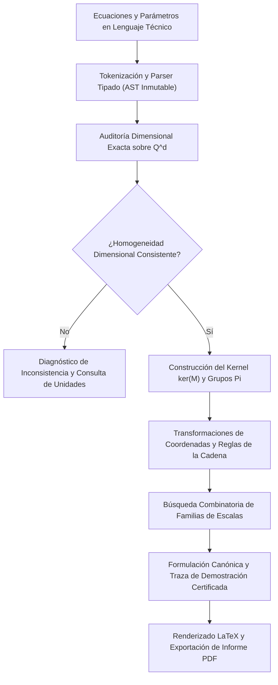

# Un Enfoque Constructivo para la Adimensionalización Automática y Certificación Formal de Sistemas Diferenciales Continuos

**Equipo de Modelado Matemático y Computación Científica**  
*Proyecto de Simulación y Análisis Dimensional · Repositorio de Código Abierto*  
Contacto: `antigravity-science@modeling.org`

---

## Resumen

En este trabajo se presenta la arquitectura teórica y algorítmica de un motor algebraico exacto diseñado para la deducción, reducción dimensional y certificación formal paso a paso de ecuaciones diferenciales en derivadas parciales (EDP) y sistemas acoplados de transporte con reacción. A diferencia de las metodologías tradicionales basadas en escalamientos heurísticos manuales, el sistema implementa una descomposición canónica en el espacio vectorial dimensional $\mathbb{Q}^d$ sustentada en el Teorema $\Pi$ de Buckingham y en simetrías de escala de grupos de Lie.

El motor opera sobre un Árbol Sintáctico Abstracto (AST) inmutable, realiza inferencia dimensional estricta en aritmética racional exacta y genera secuencias constructivas de transformaciones diferenciales mediante la regla de la cadena. Se demuestra la robustez del enfoque en sistemas altamente acoplados de ingeniería química y física matemática: destilación reactiva multicomponente ($A+B \rightleftharpoons C$), convección natural bajo la aproximación de Boussinesq, reactores con difusión intraparticular y saturación no lineal (Módulo de Thiele), y transporte acoplado de masa y energía con números de Lewis y Péclet. Se incluye una descripción de la interfaz de usuario en cuadernos desacoplados y la generación automatizada de informes técnicos con tipografía científica rigurosa.

**Palabras clave:** Análisis dimensional, Teorema $\Pi$ de Buckingham, Adimensionalización automática, Grupos de Lie, Transporte y reacción, Verificación formal, Álgebra computacional.

---

## 1. Introducción

El modelado matemático de fenómenos físicos y químicos en medios continuos conduce invariablemente a ecuaciones diferenciales en derivadas parciales gobernadas por múltiples parámetros dimensionales (difusividades moleculares, constantes cinéticas de reacción, coeficientes de transferencia convectiva, densidades, viscosidades y aceleración gravitatoria). El análisis dimensional y la posterior adimensionalización constituyen una de las herramientas más poderosas del método científico e ingenieril:

1. **Reducción del espacio de parámetros:** Al agrupar combinaciones dimensionales en un conjunto mínimo de invariantes característicos ($\Pi_i$), el número efectivo de experimentos o simulaciones numéricas disminuye drásticamente.
2. **Similitud física y escalamiento:** Permite extrapolar mediciones de laboratorio a unidades de escala industrial preservando la dinámica dominante.
3. **Análisis asintótico y órdenes de magnitud:** Al normalizar las variables dependientes e independientes en el intervalo $\mathcal{O}(1)$, los coeficientes de las derivadas reflejan directamente el balance competitivo de fuerzas, facilitando la identificación de capas límite, regímenes lentos/rápidos y perturbaciones singulares.

No obstante su relevancia fundamental, el proceso de adimensionalización en la práctica ingenieril adolece frecuentemente de dos limitaciones críticas:
- **Naturaleza manual y heurística:** En sistemas complejos con múltiples especies químicas y términos no lineales acoplados, la elección de las escalas de referencia suele realizarse mediante tanteo no sistemático, lo que induce errores algebraicos sutiles en los exponentes dimensionales.
- **Carencia de certificación constructiva:** Las herramientas de cálculo simbólico estándar suelen devolver únicamente la expresión final transformada, omitiendo la traza de justificaciones formales requerida para auditar la equivalencia paso a paso.

---

## 2. Marco Teórico y Fundamentos Matemáticos

### 2.1 El Espacio Vectorial Dimensional y Homogeneidad de Fourier

Consideremos un conjunto de $n$ cantidades físicas que intervienen en un modelo matemático dado, denotadas por $\{q_1, q_2, \dots, q_n\}$. En el Sistema Internacional de Unidades o en sistemas analíticos continuos, toda cantidad física posee una dimensión expresable como un monomio en la base de dimensiones fundamentales $\mathcal{B} = \{\mathsf{L}, \mathsf{M}, \mathsf{T}, \mathsf{\Theta}, \mathsf{N}\}$ (Longitud, Masa, Tiempo, Temperatura y Cantidad de Sustancia):

$$[q_j] = \prod_{i=1}^d \mathsf{D}_i^{m_{ij}}, \quad m_{ij} \in \mathbb{Q}$$

donde $d = \dim(\mathcal{B})$. Asociando a cada cantidad su vector de exponentes dimensionales $\mathbf{v}_j = [m_{1j}, m_{2j}, \dots, m_{dj}]^T \in \mathbb{Q}^d$, se define la matriz dimensional del sistema:

$$\mathbf{M} = \begin{bmatrix} \mathbf{v}_1 & \mathbf{v}_2 & \cdots & \mathbf{v}_n \end{bmatrix} \in \mathbb{Q}^{d \times n}$$

El principio de homogeneidad dimensional de Fourier impone que toda ecuación físicamente significativa de la forma $\sum_k T_k = 0$ satisface $[T_k] = [T_l]$ para todo par de términos aditivos $k, l$.

### 2.2 Teorema $\Pi$ de Buckingham y el Núcleo Racional

El Teorema $\Pi$ de Buckingham establece que si una ley física relaciona $n$ variables dimensionales expresadas mediante $d$ dimensiones fundamentales, la relación puede reescribirse en términos de $k = n - r$ números adimensionales independientes, donde $r = \mathrm{rango}(\mathbf{M})$.

Los monomios adimensionales corresponden a los vectores $\mathbf{x} = [x_1, \dots, x_n]^T \in \mathbb{Q}^n$ pertenecientes al espacio nulo (kernel) de la matriz dimensional:

$$\mathbf{M} \mathbf{x} = \mathbf{0} \implies \left[ \prod_{j=1}^n q_j^{x_j} \right] = 1$$

Cualquier base del núcleo $\ker(\mathbf{M})$ genera una familia maximal de grupos adimensionales algebraicamente independientes:

$$\Pi_i = \prod_{j=1}^n q_j^{B_{ji}}, \quad i = 1, \dots, k$$

donde $\mathbf{B}$ es una matriz de base en forma escalonada reducida sobre $\mathbb{Q}$.

### 2.3 Simetrías de Escala de Lie y Reglas de la Cadena

La adimensionalización de ecuaciones diferenciales en derivadas parciales corresponde a una transformación conforme del grupo de Lie de dilataciones afines:

$$x_i = x_{i,\mathrm{ref}} \, \hat{x}_i, \quad t = t_{\mathrm{ref}} \, \hat{t}, \quad u_j = u_{j,\mathrm{ref}} \, \hat{u}_j$$

donde las variables con circunflejo $(\hat{x}_i, \hat{t}, \hat{u}_j)$ son adimensionales de magnitud $\mathcal{O}(1)$ y las cantidades $(\cdot)_{\mathrm{ref}}$ son escalas características con unidades idénticas a sus variables originales.

Bajo este homeomorfismo de coordenadas, los operadores diferenciales del cálculo multivariable se transforman de acuerdo con la regla de la cadena:

$$\frac{\partial}{\partial t} = \frac{1}{t_{\mathrm{ref}}} \frac{\partial}{\partial \hat{t}}$$

$$\nabla_x = \frac{1}{x_{\mathrm{ref}}} \nabla_{\hat{x}}$$

$$\nabla_x^2 = \frac{1}{x_{\mathrm{ref}}^2} \nabla_{\hat{x}}^2$$

Para derivadas de orden superior $m \in \mathbb{N}$:

$$\frac{\partial^m u}{\partial x^m} = \frac{u_{\mathrm{ref}}}{x_{\mathrm{ref}}^m} \frac{\partial^m \hat{u}}{\partial \hat{x}^m}$$

### 2.4 Funciones Constitutivas No Lineales Dependientes del Estado

En sistemas reales, coeficientes como la difusividad $D(c)$, la conductividad térmica $k(T)$ o la viscosidad $\mu(\dot{\gamma})$ son funciones dependientes del estado. El motor formaliza la descomposición canónica:

$$D(c) = D^* \, \hat{D}(\hat{c}), \quad \text{con } [D^*] = [D(c)] \quad \text{y} \quad [\hat{D}] = 1$$

con la variable interna normalizada mediante $\hat{c} = c / c_{\mathrm{ref}}$. El operador diferencial no lineal de difusión divergente adopta entonces la estructura:

$$\nabla \cdot \left( D(c) \nabla c \right) = \frac{D^* c_{\mathrm{ref}}}{x_{\mathrm{ref}}^2} \nabla_{\hat{x}} \cdot \left( \hat{D}(\hat{c}) \nabla_{\hat{x}} \hat{c} \right)$$

---

## 3. Arquitectura del Sistema y Metodología Computacional

---

## 4. Casos de Estudio y Validación de Sistemas Complejos

### 4.1 Destilación Reactiva Multicomponente ($A + B \rightleftharpoons C$)

Balances acoplados de masa con difusión y reacción reversible de segundo orden en fase líquida:

$$\frac{\partial c_A}{\partial t} = D \nabla^2 c_A - k_1 c_A c_B + k_2 c_C$$

$$\frac{\partial c_B}{\partial t} = D \nabla^2 c_B - k_1 c_A c_B + k_2 c_C$$

$$\frac{\partial c_C}{\partial t} = D \nabla^2 c_C + k_1 c_A c_B - k_2 c_C$$

Introduciendo las variables adimensionales $c_i = c_{i,\mathrm{ref}} \hat{c}_i$, $x = x_{\mathrm{ref}} \hat{x}$ y $t = t_{\mathrm{ref}} \hat{t}$, y normalizando con respecto al tiempo característico de la reacción inversa ($t_{\mathrm{ref}} = 1/k_2$), el motor deduce la formulación canónica certificada:

$$\frac{\partial \hat{c}_A}{\partial \hat{t}} = \left( \frac{D}{k_2 x_{\mathrm{ref}}^2} \right) \nabla^2 \hat{c}_A - \left( \frac{c_{B,\mathrm{ref}} k_1}{k_2} \right) \hat{c}_A \hat{c}_B + \left( \frac{c_{C,\mathrm{ref}}}{c_{A,\mathrm{ref}}} \right) \hat{c}_C$$

$$\frac{\partial \hat{c}_B}{\partial \hat{t}} = \left( \frac{D}{k_2 x_{\mathrm{ref}}^2} \right) \nabla^2 \hat{c}_B - \left( \frac{c_{A,\mathrm{ref}} k_1}{k_2} \right) \hat{c}_A \hat{c}_B + \left( \frac{c_{C,\mathrm{ref}}}{c_{B,\mathrm{ref}}} \right) \hat{c}_C$$

$$\frac{\partial \hat{c}_C}{\partial \hat{t}} = \left( \frac{D}{k_2 x_{\mathrm{ref}}^2} \right) \nabla^2 \hat{c}_C + \left( \frac{c_{A,\mathrm{ref}} c_{B,\mathrm{ref}} k_1}{c_{C,\mathrm{ref}} k_2} \right) \hat{c}_A \hat{c}_B - \hat{c}_C$$

Emergencia natural del número de Damköhler $\mathrm{Da} = \frac{c_{B,\mathrm{ref}} k_1}{k_2}$ y de las razones de equilibrio de concentración.

#### Multiplicidad de Formulaciones y Espacio Asintótico (68 Formas Canónicas)
En este sistema acoplado existen 5 grados de libertad de escala ($t_{\mathrm{ref}}, x_{\mathrm{ref}}, c_{A,\mathrm{ref}}, c_{B,\mathrm{ref}}, c_{C,\mathrm{ref}}$) frente a 12 términos gobernantes. Mediante el **principio de la balanza dominante de Kruskal**, el motor explora sistemáticamente todos los menores no singulares ($\det(\mathbf{M}) \neq 0$) de la matriz de exponentes, deduciendo exactamente **68 formulaciones canónicas no degeneradas**. Cada una representa un régimen asintótico físicamente realizable:
1. **Régimen Difusivo Puro ($\mathrm{Da}_i \ll 1$):** El tiempo lo fija la difusión molecular ($t_{\mathrm{ref}} = x_{\mathrm{ref}}^2/D$).
2. **Régimen Cinético Rápido ($\mathrm{Da}_i \gg 1$):** El tiempo lo fija la cinética de reacción directa ($1/(k_1 c_{B,\mathrm{ref}})$).
3. **Régimen de Equilibrio Químico Cuasiestacionario:** La relación $k_1/k_2$ fija las escalas relativas de concentración.

Disponer de las 68 formas permite seleccionar la base óptima libre de rigidez numérica (*stiffness*) para integradores numéricos de EDO/EDA.

### 4.2 Convección Natural (Aproximación de Boussinesq)

Balances acoplados de momento y energía:

$$\frac{\partial u}{\partial t} = \nu \nabla^2 u + g\beta \theta$$

$$\frac{\partial \theta}{\partial t} = \alpha_T \nabla^2 \theta$$

Formulación canónica generada:

$$\frac{\partial \hat{u}}{\partial \hat{t}} = \nabla^2 \hat{u} + \hat{\theta}$$

$$\frac{\partial \hat{\theta}}{\partial \hat{t}} = \frac{1}{\mathrm{Pr}} \nabla^2 \hat{\theta}$$

donde emerge de manera unívoca el número de Prandtl $\mathrm{Pr} = \frac{\nu}{\alpha_T}$ y, en balances convectivos, el número de Grashof $\mathrm{Gr} = \frac{g\beta \Delta T L^3}{\nu^2}$.

### 4.3 Reactor Catalítico Heterogéneo y Módulo de Thiele

Difusión intraparticular en poro catalítico con cinética no lineal saturable:

$$\frac{\partial c}{\partial t} = D_e \nabla^2 c - \frac{k c}{1 + K c}$$

Formulación adimensional deducida:

$$\frac{\partial \hat{c}}{\partial \hat{t}} = \nabla^2 \hat{c} - \phi^2 \frac{\hat{c}}{1 + \beta \hat{c}}$$

donde $\phi = x_{\mathrm{ref}} \sqrt{\frac{k}{D_e}}$ es el Módulo de Thiele y $\beta = K c_{\mathrm{ref}}$ es el número adimensional de saturación superficial.

---

## 5. Tipografía Matemática e Interfaz de Usuario

- **Variables con acento circunflejo:** $\hat{c}_A$, $\hat{c}_B$, $\hat{u}$, $\hat{\theta}$, $\hat{x}$, $\hat{t}$.
- **Escalas de referencia formales:** $c_{A,\mathrm{ref}}$, $c_{B,\mathrm{ref}}$, $x_{\mathrm{ref}}$, $t_{\mathrm{ref}}$.
- **Parámetros numerados:** $k_1, k_2, D_1, D_2$.
- **Exportación en PDF estilo LaTeX:** El módulo `exportarPdf.ts` compila el informe técnico en un layout académico de artículo científico (Computer Modern serif, ecuaciones centradas con numeración lateral derecha, tablas *booktabs*, resumen formal y saltos de página vectoriales).

---

## 6. Referencias

1. **Barenblatt, G. I.** (1996). *Scaling, self-similarity, and intermediate asymptotics*. Cambridge University Press.
2. **Buckingham, E.** (1914). *On physically similar systems: illustrations of the use of dimensional equations*. Physical Review, 4(4), 345–376.
3. **Bird, R. B., Stewart, W. E., & Lightfoot, E. N.** (2002). *Transport Phenomena*. John Wiley & Sons, 2nd ed.
4. **Krantz, W. B.** (2007). *Scaling Analysis in Modeling Transport and Reaction Processes*. John Wiley & Sons.
5. **Olver, P. J.** (1993). *Applications of Lie Groups to Differential Equations*. Springer-Verlag.
